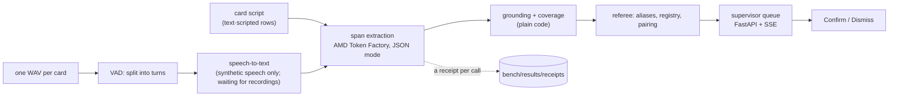

<div align="center">
  
  <h1>SayAgain 📻</h1>
  <p><em>Checks every radio read-back of a safety instruction, and sends the wrong ones to a human.</em></p>
  

  <br/>

  [](https://sayagain.edycu.dev/)
  [](https://sayagain.edycu.dev/replay/)
  [](https://sayagain.edycu.dev/pitch/)
  [](https://lablab.ai/ai-hackathons/amd-developer-hackathon-act-iii/edy-team/sayagain-catches-wrong-radio-read-backs)
  [](https://lablab.ai/ai-hackathons/amd-developer-hackathon-act-iii)

  <br/>

  
  
  
  
  [](https://opensource.org/licenses/MIT)
  [](https://github.com/edycutjong/sayagain/actions/workflows/ci.yml)
  [](https://github.com/edycutjong/sayagain/releases)

</div>

---

**Track:** Intelligent Industry · lablab AMD Developer Hackathon ACT III

> **Status: AMD Developer Hackathon ACT III submission (Oct 2026).** Built and tested: the referee, span extraction on the
> AMD Token Factory with a receipt per call, the supervisor queue and its static replay. Measured on the written words of the
> 145 recording cards (`text·scripted`, 89 held out), plus exploratory synthetic-speech rows (`tts·synthetic`, below); no human
> recording has been measured yet. Every result below comes from a file in `bench/results/`.

## 📸 See it in Action

**Live:** [queue replay](https://sayagain.edycu.dev/replay/) · [landing page](https://sayagain.edycu.dev/) · [pitch deck](https://sayagain.edycu.dev/pitch/) — static pages on GitHub Pages, replaying stored runs.

The supervisor queue, replaying a stored run over the 145 recording cards. Red marks only the read-back word that differs from
the instruction; the card leaves the queue only through **Confirm**, or **Dismiss** (a reason is required).

| The hero exchange | The refused one | End of shift |
|---|---|---|
|  |  |  |

Every card says where each stage ran (`speaker`, `radio`, `extraction`, `referee`) and lists the receipt of each model call
behind it. The words on these cards are the recording cards' scripts (`text·scripted`): the replay carries no recorded audio yet, and the card
says so where a waveform will go.

## 💡 The Problem & Solution

### The Problem

An operator radios *"Close valve two-oh-three, line Bravo."* The field technician answers *"Copy, closing two-oh-eight,
line Bravo."* Valve XV-208 is on a different line. The read-back exists so the operator catches this, and sometimes
nobody does.

### The Solution

SayAgain takes the transcript of both turns (today: the cards' written words) and asks a language model to **point at the
words** that carry the action, the equipment tag and the line. **Plain code** then decides: the words must really be in the transcript, every safety word
must be accounted for, spoken digits and NATO letters become plant tags through alias tables, and a pure function returns
`VERIFIED`, `MISMATCH`, `NO-READBACK` or `ABSTAIN`. A shift supervisor confirms or dismisses every card. Nothing is ever
sent to the plant.

The referee half of that design exists and is tested today; the speech half has run only on synthetic speech and waits for human recordings.

## 🏗️ Architecture & Tech Stack


<details><summary>The same flow as a Mermaid chart</summary>



</details>

| Layer | Choice |
|---|---|
| Language, runtime | Python 3.11, `uv` |
| Server | FastAPI, server-sent events, SQLite for reviews |
| Extraction | AMD Token Factory (OpenAI-compatible), `json_object` mode, validated locally, fails closed to `NOT_AUDITED` |
| Referee | pure Python; the verdict module imports no model code (`tests/test_verdict.py`) |
| Front end | one static page, no framework: `web/` (live) and `docs/replay/` (static export of the same page) |
| Quality | ruff, pytest, pip-audit, gitleaks; GitHub Actions workflows and CodeQL |

### Build status (2026-10-15)

| Part | Where | State |
|---|---|---|
| Eval protocol, pre-registered before any model call on recorded data | `bench/PROTOCOL.md`, git tag `prereg-v1` | done |
| Regex extractor (rung 0, no model) | `referee/regex_extractor.py` | frozen at `prereg-v1` |
| Alias tables (English + Bahasa digits, NATO, tag nouns, actions, negators) | `referee/aliases.py` | from `prereg-v1`, plus the hardening listed under Deviations in `bench/PROTOCOL.md` |
| Referee: grounding, coverage + retraction cues, registry precedence, pairing (say-again, operator correction), verdict | `referee/` | done |
| Plant registry (fictional, 120 tags) and 145 recording cards | `data/`, `scripts/seed.py` | done |
| Radio-path simulation and SNR mixer | `scripts/radioize.py`, `scripts/mix.py` | done |
| AMD Token Factory client with a receipt per call; access probe | `sayagain/amd_client.py`, `scripts/access_gate.py` | probe run, see below |
| Span extraction on the AMD Token Factory: JSON mode + local schema check, 429 back-off, fail closed to `NOT_AUDITED`, a receipt per call | `sayagain/extract.py` | done, run on text rows |
| Model ladder, grounding ablation, LLM-judge baseline, offline re-scoring of every stored model output | `scripts/eval.py` | run on the card scripts (`text·scripted`), see below |
| Speech path: one WAV per card → VAD turns → speech-to-text (local Whisper, labelled off-AMD; AMD notebook backend switched off until a notebook GPU is confirmed) → disagreement gate | `sayagain/ingest.py`, `sayagain/asr.py`, `scripts/eval_tts.py` | run end to end on synthetic speech only (`tts·synthetic`, exploratory, see below); not yet run on a human recording |
| Local kill test (Whisper-large-v3 on a laptop, off-AMD) | `scripts/kill_test_local.py` | harness ready, waiting for recordings |
| Supervisor queue: read-back strip card, confirm, or dismiss with a required reason, "Try the refused one", end-of-shift list (spot-checks, caught on channel, not audited, read-backs with no order heard), receipts per model call | `sayagain/server.py`, `sayagain/shift.py`, `web/` | done, over the stored text runs |
| Static replay of stored runs (same page, live at [sayagain.edycu.dev/replay/](https://sayagain.edycu.dev/replay/)) | `scripts/export_run.py` → `docs/replay/` | done |
| Landing page and pitch deck with its PDF, built from the stored results and the sources listed in `evidence/sources.json` (live at [sayagain.edycu.dev](https://sayagain.edycu.dev/)) | `docs/index.html`, `docs/pitch/` | done |
| Human recordings and the pre-registered audio rows | — | not run yet (exploratory synthetic-speech rows: see below) |

## 🏆 AMD Token Factory Integration

Span extraction is the one model job in the pipeline, and it runs on the AMD Token Factory: `sayagain/amd_client.py` is the
client (a receipt per call with request id, model served, host, latency and cost; a 429 is reported as not audited),
`sayagain/extract.py` the extraction stage (JSON mode, 429 back-off, schema checked in code, fail closed).

How to read the rows below: a **rung** is one extractor tried in turn, from the plain regex (rung 0, no model) to the larger
models; the **ladder rule** (pre-registered in `bench/PROTOCOL.md`) picks the smallest rung that lets **0 wrong read-backs
through as VERIFIED** (*false-VERIFIED*) while bothering the supervisor on no more than a pre-registered threshold of the correct ones (*false-alarm
load*); `text·scripted` marks rows run on the cards' written words, with no audio; a Wilson interval is the range a
rate could plausibly have, given so few cards.

### First measurements: the card scripts, no audio yet (2026-10-14)

These rows feed the **written words of the 145 recording cards** to each extractor (`text·scripted`): no microphone,
no speech-to-text. They are each rung's result on clean written words (no speech-to-text error), not the audio result the protocol pre-registers
(bench/PROTOCOL.md). Scored on the 89 held-out cards: the hero and its secondary, plus the 87 A2 cards left after the
dev slice (the first 20 A2 cards and the 20 kill-test cards). Full tables with Wilson intervals: bench/results/text/RESULTS.md.

- **No wrong read-back was marked VERIFIED by any rung of the referee:** 0 false-VERIFIED for the regex rung and for all
  four models extracting spans on the AMD Token Factory (bench/results/text/ladder-r1-reaudit.json).
- **The plain regex rung already meets the ladder rule on clean words** (pre-registered for the audio row, applied here to text):
  41/41 seeded errors flagged, 0/48 false alarms (bench/results/text/ladder-r1-reaudit.json).
  By that rule, on scripted words no language model is needed. Whether that survives real speech, noise and other
  people's phrasing is what the audio rows will measure.
- **The only one of the four models that meets the rule:** Gemma-4-31B-IT,
  0 false-VERIFIED and 2/48 false alarms (bench/results/text/ladder-r1-reaudit.json), after one re-audit of the 118
  transcripts whose first call failed (108 answered with HTTP status 500 by the gateway, 10 time-outs); the as-run first pass is
  bench/results/text/ladder-r1.json. Qwen3.8-27B and DeepSeek-V4-Flash also passed no wrong read-back but raised too
  many false alarms for the shift budget. Qwen3.8-27B needed a re-audit as well
  (as run: 3 cards not audited, 39/41 errors flagged, bench/results/text/ladder-r1.json) and DeepSeek-V4-Flash one call.
- **Models that miss fail toward a human:** MiniCPM5-2B returns malformed or misplaced spans, and the referee abstains on
  all 48 correct read-backs too, 48/48 false alarms, none passed (bench/results/text/ladder-r1-reaudit.json).
- **Grounding ablation:** the same model returning normalised values instead of copied words raised false alarms
  from 2/48 to 6/48, with 1 correct card still not audited (bench/results/text/ablate-grounding-r1-reaudit.json).
  In 4 of the 6 it turned a spoken pump or motor-valve tag into an XV- valve tag the registry does not have.
- **LLM-as-judge baseline:** given the whole exchange but no plant registry, DeepSeek-V4.1-Flash passed
  2 wrong read-backs as VERIFIED (bench/results/text/llm-judge-r1-reaudit.json), both of which left out the action word.
  It also passed the refusal card, a valve that does not exist in the plant, as VERIFIED; 5 of its held-out cards were
  still not audited after the re-audit.

Every call above has a receipt in bench/results/receipts/, and `uv run python scripts/eval.py --rescore` re-judges
every stored model output offline and re-derives the per-rung rows, call metrics and rule outcome of every ladder, ablation, LLM-judge and dev-slice run file (it reports OK for each; the repeat-run comparison files are not re-derived). A second live run of
DeepSeek-V4-Flash on the dev slice gave the same verdict on 40/40 cards (bench/results/text/repro-dev-DeepSeek-V4-Flash.json),
with every extraction identical but one turn's `kind` (same file) and one re-audit of 3 transcripts (bench/results/text/dev-r2-repro-reaudit.json);
temperature 0 gives no determinism guarantee at this gateway, so this is measured, not guaranteed.

The access probe (bench/results/access-gate.json) listed 11 instruct models on the AMD Token Factory; 8 of them returned a span
extraction of the hero read-back that the referee reads as `CLOSE · XV-208 · line B` (the probe answer of Gemma-4-31B-IT was not
valid JSON, and it meets the rule in the ladder re-audit). The model list has no speech-to-text model, so
transcription will run elsewhere, and every stage will be labelled with where it ran. Friction log:
[docs/DX-REPORT.md](docs/DX-REPORT.md).

### Exploratory: synthetic speech (not the pre-registered audio row)

ElevenLabs text-to-speech of the 145 card scripts (two voices; bench/results/tts/manifest.json), through the simulated radio path, transcribed by local Whisper-large-v3 (off-AMD), with spans extracted on the AMD Token Factory (Gemma-4-31B-IT) or by the regex rung (`tts·synthetic`, `scripts/eval_tts.py`). **No human recording has been evaluated.** This run was added after the text rows, is not pre-registered (bench/PROTOCOL.md, Deviations, 2026-10-15) and does not replace the audio row; referee, aliases and thresholds were frozen for it. Scored on the same 89 held-out cards, with the disagreement gate between a prompted and an unprompted Whisper pass. Tables and Whisper WER per card set: bench/results/tts/RESULTS.md.

- **0 false-VERIFIED in every row run:** regex at all four noise levels and Gemma-4-31B-IT at radio without noise and at −6 dB, 0/41 seeded errors each, Wilson interval 0 % to 8.57 % (bench/results/tts/tts-r1-radio-clean.json, bench/results/tts/tts-r1-radio-clean-reaudit3.json, bench/results/tts/tts-r1-radio-p6dB.json, bench/results/tts/tts-r1-radio-0dB.json, bench/results/tts/tts-r1-radio-m6dB.json, bench/results/tts/tts-r1-radio-m6dB-reaudit2.json).
- **Radio, no noise:** Whisper's word error rate on the held-out cards was 0.87 % (10/1150 words). Regex flagged 39/41 seeded errors with 16/48 false alarms (33.33 %, 21.68 % – 47.46 %; bench/results/tts/tts-r1-radio-clean.json); Gemma, fully audited after three re-audit passes, flagged 39/41 with 17/48 false alarms (35.42 %, 23.43 % – 49.56 %; bench/results/tts/tts-r1-radio-clean-reaudit3.json). On written words the same rungs had 0/48 and 2/48: transcription turns correct read-backs into abstains (spoken digit runs split by commas, the two Whisper passes disagreeing; one regex false alarm, A2-030, is a false MISMATCH instead), so neither rung meets the 5 % false-alarm budget on synthetic speech.
- **Seeded errors that formed no card at all:** 2/41 at radio without noise on both rungs, where Whisper wrote "for three Bravo" (A2-032) and "tutu, hotel" (A2-097) for the tag in the instruction, so no order was heard (bench/results/tts/tts-r1-radio-clean.json, bench/results/tts/tts-r1-radio-clean-reaudit3.json); 26/41 at −6 dB on both rungs (bench/results/tts/tts-r1-radio-m6dB.json, bench/results/tts/tts-r1-radio-m6dB-reaudit2.json). None was marked VERIFIED, but none raised a live card either; the stricter form of the ladder rule counts them as failures.
- **Noise sweep, regex rung** (MIMII machine noise before the radio, held-out word error rate): +6 dB 38/41 flagged, 36/48 false alarms, 9.57 % (bench/results/tts/tts-r1-radio-p6dB.json); 0 dB 36/41, 43/48, 51.39 % (bench/results/tts/tts-r1-radio-0dB.json); −6 dB 15/41, 14/48, 85.13 % (bench/results/tts/tts-r1-radio-m6dB.json). Gemma was run at −6 dB only among the noisy levels: 15/41 and 14/48 once fully audited (bench/results/tts/tts-r1-radio-m6dB-reaudit2.json).
- **The hero exchange** (H-01, "two-oh-eight" read back for two-oh-three) is `MISMATCH · tag: XV-203 ≠ XV-208` at radio without noise on both rungs (bench/results/tts/tts-r1-radio-clean.json, bench/results/tts/tts-r1-radio-clean-reaudit3.json) and an abstain at −6 dB (bench/results/tts/tts-r1-radio-m6dB.json, bench/results/tts/tts-r1-radio-m6dB-reaudit2.json); the refusal card R-01 abstains as an unknown tag in every final row.
- **The gateway failed most first-pass calls:** 265 of Gemma's 312 calls at radio without noise ended in a server error or a time-out (bench/results/tts/tts-r1-radio-clean.json), so that row needed three re-audit passes; the extraction calls of all these runs cost $0.002448 together (bench/results/tts/spend.json).

## 📊 Engineering Rigor

767 tests (`uv run pytest`; one runs only with local Whisper weights), ruff lint and format, `pip-audit` and gitleaks over the
full history (`make ci`, `make secrets`), the same checks plus CodeQL in GitHub Actions on every push (see Testing & CI), and a readiness gate (`scripts/check_submission_readiness.py`) that fails the build on an unfilled
placeholder, a hardware or serving-stack name no receipt backs, or a number its cited file does not contain.

### Attacks defeated

| Control | Why it is load-bearing | Test |
|---|---|---|
| A model-invented span is ungrounded | The extractor may only point at words in the transcript | `tests/test_grounding_coverage.py:36` |
| A real but wrong word fails coverage | Returning "line Alpha" and dropping the spoken correction to Bravo must not pass | `tests/test_grounding_coverage.py:60` |
| A wide span cannot hide a safety word | A span that swallows a second command or a stray line is not accepted as one command | `tests/test_review_round2.py:70` |
| A span that drops part of the tag or the equipment word cannot verify | "valve two-oh-three-eight" and "pump" for "valve" must not read as a match | `tests/test_review_round4.py:34` |
| A negated command never verifies | "not closing", "will not close" or a negated order must reach a human | `tests/test_review_round1.py:31` |
| Swapped actions between two commands cannot verify | A model that reports the swapped actions must not turn the error into a pass | `tests/test_review_round1.py:52` |
| A retraction needs a spoken cue | A silent "correction" must not clear a wrong read-back | `tests/test_grounding_coverage.py:74` |
| A retraction must be replaced by words of its own kind, after the cue | Otherwise a model that takes back the later tag verifies a technician's self-correction to the wrong valve, or one that takes back an order's verb and tag drops it from the live queue | `tests/test_review_round5.py:61` |
| No sampled extraction of a self-corrected read-back verifies a wrong final reading | 3,000 seeded read-backs with spoken corrections, each read by an extractor that groups and retracts the turn's real safety words at random: the referee may abstain or flag, never verify a wrong valve, action or line | `tests/test_review_round5.py:134` |
| A correction without a new read-back keeps the wrong one live | The operator saying "Negative" is not the technician fixing it | `tests/test_review_round1.py:91` |
| An unreadable second read-back in which code hears an action, a tag or a line is judged, never taken as the acknowledgement | An extraction the referee cannot read of "Copy, closing two-oh-eight" after a correct read-back must not let the exchange stand VERIFIED (a failed model call goes to the end-of-shift list as not audited) | `tests/test_review_round5.py:190` |
| A `NOT_AUDITED` turn is never VERIFIED | A failed model call must not become a pass | `tests/test_verdict.py:196` |
| A referee exception fails closed, while reading, pairing or judging a turn | A bug must reach a human, not a log, and never end the shift; the benchmark stops on one instead of counting it | `tests/test_verdict.py:203`, `tests/test_review_round5.py:168` |
| The verdict module imports no model code | The verdict cannot be moved into the model | `tests/test_verdict.py:215` |
| A page on another site cannot dismiss a card or start paid calls | The local queue has no login: a foreign Host header (DNS rebinding) gets 400, a write or live stream from another site or another local port gets 403 | `tests/test_review_round5.py:256` |

### Honest limits (9)

1. No human recording has been measured. The scored rows are `text·scripted` (each rung's result on clean written words) and the exploratory `tts·synthetic` rows (ElevenLabs voices through the simulated radio path), which are not pre-registered and say nothing about a technician on a real radio.
2. The held-out set is 89 cards, so the intervals are wide: the best model's 2/48 false alarms is a 4.17 % rate with a Wilson interval of 1.15 % to 13.98 % (bench/results/text/RESULTS.md).
3. On scripted words the plain regex rung meets the rule with no model, so what a language model adds is unproven until the audio rows exist.
4. The plant, its 120 tags and every exchange are fictional; the error mix is seeded, not sampled from a real site.
5. The first Gemma-4-31B-IT pass left 45 of the 89 held-out cards not audited; the headline row is a re-audit of those, and the as-run pass is kept next to it (bench/results/text/ladder-r1.json).
6. Temperature 0 does not make the gateway deterministic; the repeat run agreed on 40/40 cards (bench/results/text/repro-dev-DeepSeek-V4-Flash.json), which is evidence and not a guarantee.
7. The Token Factory is a hosted API: receipts name the model and host, never a GPU, so no page here claims one (`on_amd` in a receipt means only that the endpoint host is under amd.com or amd.com.cn; the receipts' host is developer.amd.com.cn).
8. The gateway ignores `logprobs` for the extraction models. Speech-to-text is planned on local Whisper, whose token probabilities can feed the confidence floor, with the disagreement gate between two transcription passes as the fallback; neither has run on a human recording. Among eval rows, the disagreement gate has run only in the exploratory synthetic-speech rows (`tts·synthetic`). On audio, the confidence floor has run only on one synthetic clip, `tts·fixture`, in an opt-in unit test; other unit tests feed it hand-written token probabilities, and it has never run in an eval row.
9. The static replay shows stored verdicts. The live queue calls the API only when `SAYAGAIN_LIVE_EXTRACT=1`, paced and capped per process.

## 🚀 Getting Started

### Prerequisites

- Python 3.11 and [`uv`](https://docs.astral.sh/uv/)
- Optional, only to call the AMD Token Factory yourself: `AMD_TF_API_KEY` and `AMD_TF_BASE_URL` in
  `~/.config/amd-tokenfactory/env` (the names are in `.env.example`; a key never goes in this tree)

### Installation

```bash
uv sync --locked
uv run pytest -q
uv run python scripts/seed.py --seed 1018          # registry + cards, byte-identical
uv run python scripts/check_submission_readiness.py
```

### The supervisor queue

```bash
uv run uvicorn sayagain.server:app --port 8018     # open http://127.0.0.1:8018/queue
uv run python scripts/export_run.py                # static replay of the stored runs -> docs/replay/
```

The queue replays a shift from a stored run: the referee judges each exchange from the model output the run
recorded, and every card shows the receipt of each model call (request id, model served, host, latency, cost).
`SAYAGAIN_LIVE_EXTRACT=1` lets the server call the AMD Token Factory for each turn instead of replaying the stored output
(paced, capped per process; a failed call is `NOT_AUDITED`). The server is a local tool: it answers only to a Host header
that names this machine (`localhost` or the loopback address), and the one write and the paid live calls refuse a request
a browser marks as coming from another site, or from another port on this host.

## 🧪 Testing & CI

```bash
make ci            # ruff, pytest with coverage, pip-audit, readiness: the checks the CI workflow runs
make secrets       # gitleaks over the whole git history
uv run python scripts/eval.py --rescore   # re-judge every stored model output offline
```

Workflows in `.github/workflows/`: `ci` (quality + security jobs), `gitleaks` (full history), `codeql` (Python and
JavaScript), `release` (semantic version tag from conventional commits). Dependabot is grouped and monthly; major bumps are ignored for
Python dependencies. The workflows have run on every push since 2026-10-15 (before that, runs on the private repository could not
start because of a GitHub account billing block); the CI badge at the top shows the latest run. The same checks run locally with
`make ci` and `make secrets`.

## 📁 Project Structure

```
referee/        pure-Python referee: aliases, grounding, coverage, pairing, registry, verdict
sayagain/       AMD Token Factory client, extraction, speech path, queue server, shift list
scripts/        seed, radio simulation, eval ladder, export, access probe, readiness gate
web/            the queue page (one static page, no framework)
docs/           landing page, pitch deck + PDF (docs/pitch), static replay (docs/replay), screenshots, DX report
evidence/       recorded terminal sessions, live-call receipts, the external sources the pages quote
bench/          pre-registered protocol and every stored result and receipt
data/           fictional plant registry and the 145 recording cards
tests/          767 tests, with regression tests from five review rounds (`test_review_round*.py`)
```

## 🗺️ Roadmap

- [x] Pre-registered protocol and frozen regex rung
- [x] Referee with grounding, coverage, pairing and fail-closed verdicts
- [x] Model ladder, grounding ablation and LLM-judge baseline on the AMD Token Factory (`text·scripted`)
- [x] Supervisor queue and static replay
- [ ] Human recordings, one WAV per card
- [ ] Audio rows: local kill test, speech-to-text, headline row and failure case
- [ ] Blind auditor set
- [x] Landing page and pitch deck with its PDF (`docs/`)
- [x] Demo video (on the lablab submission page)

## 📄 License

MIT, see [LICENSE](LICENSE).
